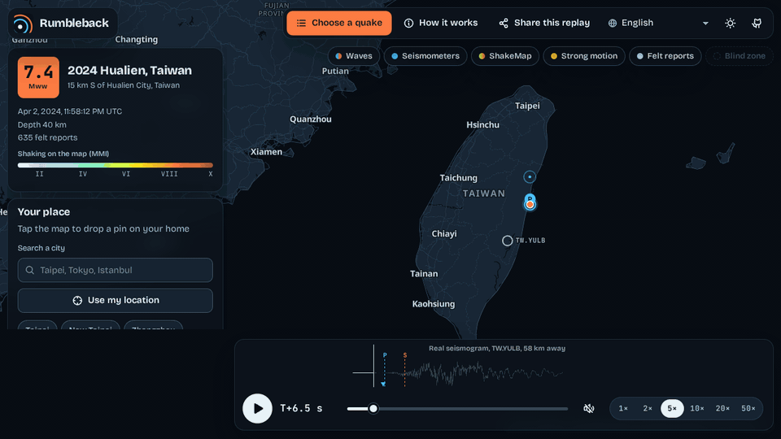
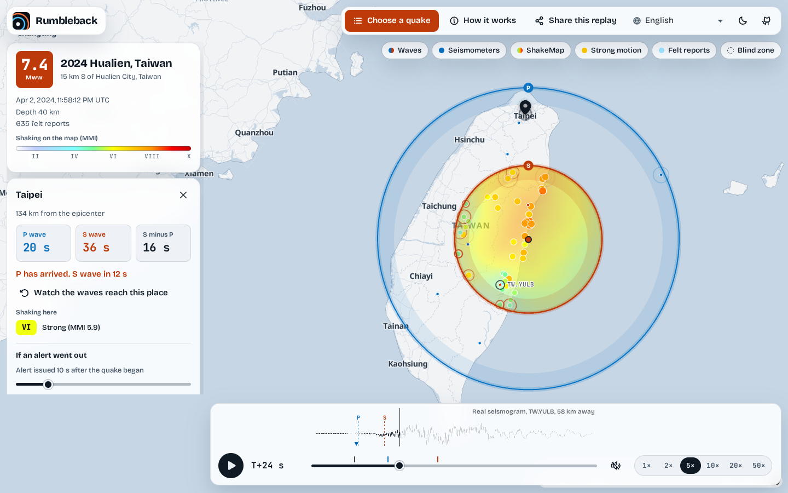
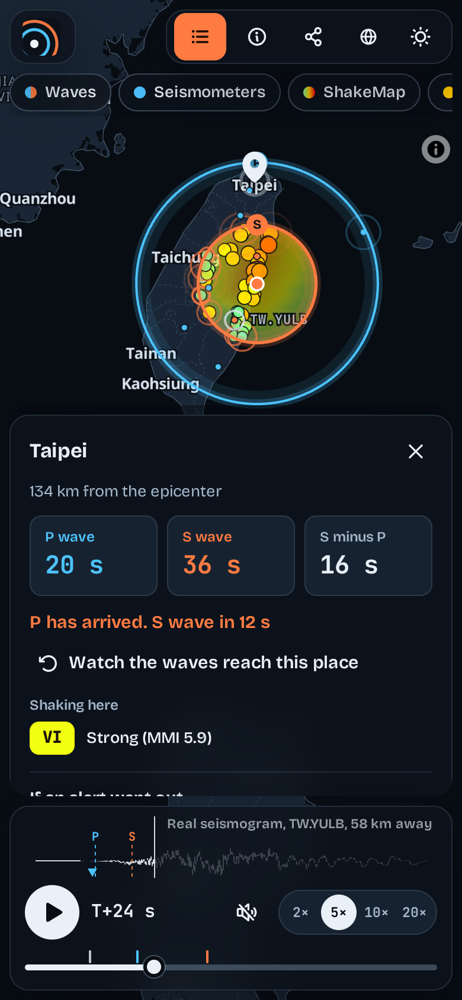
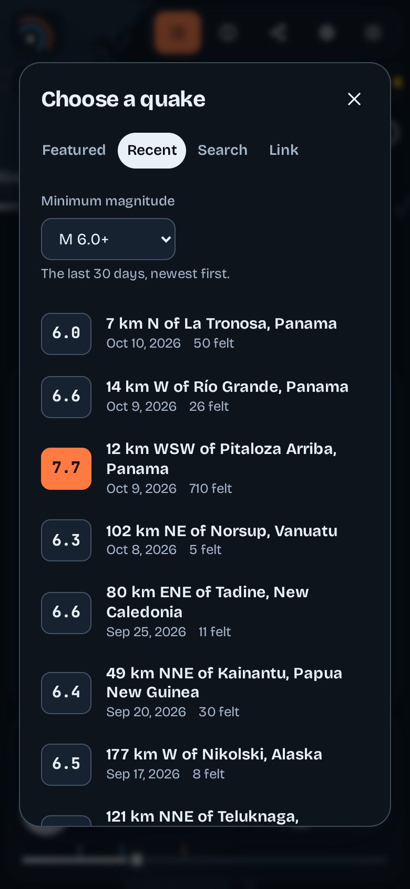

<h1 align="center">
  <br>
  Rumbleback
</h1>

<p align="center"><strong>Replay any earthquake. See your seconds.</strong></p>

<p align="center">
  <a href="https://arthur031221.github.io/Rumbleback/"></a>
  <a href="https://github.com/Arthur031221/Rumbleback/actions/workflows/ci.yml"></a>
  <a href="https://github.com/Arthur031221/Rumbleback/releases/latest"></a>
  <a href="LICENSE"></a>
  
</p>

<p align="center">
  <a href="#pick-a-story">Pick a story</a> | <a href="#try-it">Try it</a> | <a href="#before-and-after">Before and after</a> | <a href="#features">Features</a> | <a href="#how-it-works">How it works</a> | <a href="#benchmarks">Benchmarks</a> | <a href="docs/INSTALL.md">Docs</a>
</p>

<p align="center">
  <a href="README.md">English</a> | <a href="README.zh-TW.md">zh-TW</a> | <a href="README.zh-CN.md">zh-CN</a> | <a href="README.ja.md">ja</a> | <a href="README.ko.md">ko</a> | <a href="README.es.md">es</a> | <a href="README.fr.md">fr</a> | <a href="README.de.md">de</a> | <a href="README.pt-BR.md">pt-BR</a>
</p>

> [!TIP]
> Open the [live page](https://arthur031221.github.io/Rumbleback/). The 2024 Hualien quake plays automatically. Tap the map to pin your home. Press "Choose a quake" for a recent one, or paste the USGS link from a news story.

<p align="center">
  <a href="https://arthur031221.github.io/Rumbleback/"></a>
</p>

**0.66 s median error against 3,933 real P picks from 14 earthquakes.**
<sub>Observed arrival minus the iasp91 first P arrival, stations up to 95 degrees away, picks that USGS used to locate each quake (M6.8 to M9.1). Reproduce with `npm run validate`. Details in [docs/ACCURACY.md](docs/ACCURACY.md).</sub>

## Pick a story

Each link opens the live page on one quake with a pin already on a city, and the replay starts by itself. The P and S times are the model's and the shaking is the USGS ShakeMap's, the same numbers the pin card shows.

| Quake | Pin | P wave | S wave | Shaking there |
|---|---|---:|---:|---|
| [2011 Tohoku, Japan](https://arthur031221.github.io/Rumbleback/?event=official20110311054624120_30#pin=35.69,139.75), M9.1 | Tokyo, 372 km | 50 s | 90 s | MMI 6.8 |
| [2025 Mandalay, Myanmar](https://arthur031221.github.io/Rumbleback/?event=us7000pn9s#pin=13.75,100.5), M7.7 | Bangkok, 1,038 km | 135 s | 241 s | MMI 4.6 |
| [2010 Maule, Chile](https://arthur031221.github.io/Rumbleback/?event=official20100227063411530_30#pin=-33.45,-70.67), M8.8 | Santiago, 360 km | 49 s | 88 s | MMI 7.5 |
| [2024 Hualien, Taiwan](https://arthur031221.github.io/Rumbleback/?event=us7000m9g4#pin=25.03,121.56), M7.4 | Taipei, 133 km | 20 s | 36 s | MMI 5.9 |

## Why

An earthquake makes the news, and you get a magnitude and a shaded map. I wanted to see what the waves did and how many seconds I'd have had at my place. Rumbleback replays a real earthquake. You can check every claim on the screen.

- **Real data.** Every dot is a real instrument, pick or felt report from USGS. A real seismogram runs under the timeline, with the model's P and S arrivals beside the station's recorded signal. The two rings come from a published Earth model I check against ObsPy at 600 random points and against real picks on every quake.
- **Your place.** Pin your home to see when the P and S waves arrived and how strong the shaking was. Choose any alert time to see how many seconds it would've given you.
- **No server.** It's a static page. No account or analytics. Your pin never leaves the browser.

## Before and after

The same quake, the 2024 Hualien M7.4, seen from Taipei.

| What a news page gives you | What Rumbleback gives you |
|---|---|
| "M7.4, 15 km S of Hualien City, depth 40 km" | The same facts, plus how the P and S fronts crossed the island, second by second |
| A shaded intensity map | The ShakeMap revealed behind the S wave, with 354 strong motion instruments lighting up as it reaches them |
| Nothing about where you are | A pin on Taipei: P wave at 20 s, S wave at 36 s, shaking of intensity VI (MMI 5.9) |
| "Early warning exists" | A slider for the alert second: an alert at 10 s gives Taipei 26 s before the S wave |
| A model you have to trust | The model's P and S arrival drawn over a real seismogram, and a check card with 298 real P picks for this quake |

## Features

<p align="center">
  <picture>
    <source media="(prefers-color-scheme: dark)" srcset="assets/hero-dark.png">
    
  </picture>
</p>

- **Waves.** The first P and S wavefronts at the surface account for depth. For a deep quake, no ring appears until the wave reaches the surface.
- **Seismometers.** Each dot flashes at an analyst's picked P arrival time for a real station (USGS phase data).
- **Inspect a dot.** Hover over a lit dot. A station shows its pick beside the model's time. An instrument shows its intensity and peak readings. A felt report shows its count. The check card lists ten stations the same way, for a keyboard or a touch screen.
- **Seismogram.** A nearby station's real vertical trace runs along the timeline, with the model's P and S arrivals and the analyst's pick drawn over it (EarthScope archive).
- **ShakeMap, strong motion and felt reports.** The USGS intensity map, instruments coloured by the instrumental intensity USGS computed from their recordings, and Did You Feel It groups. A colour key sits in the quake card.
- **Blind zone.** The area where the S wave beat an alert issued at your chosen time.
- **Your seconds.** P and S arrivals at your pin, the gap between them, the ShakeMap intensity there and an alert slider. It's arithmetic on the model and doesn't reflect any real alert. A button replays the waves from just before they reach your pin.
- **Sound.** An optional low thump for P, a rumble for S that grows with the intensity at your pin, and a soft chime at the alert second.
- **Share.** A link, a square card, a story card and a recorded video clip. The clip saves as MP4 where the browser supports it, so it plays on an iPhone and in social apps. On a phone, a card opens the system share sheet. The link includes your pin only if you tick a box. Then it keeps the pin after the `#`, which browsers never send to a server. Cards show a city name, never coordinates.
- **Any quake.** Fourteen featured events work without calling USGS. Ten include a seismogram. Recent and Search tabs read the live USGS catalog. The Link tab opens any USGS event page or id you paste, with an EarthScope seismogram when available.
- **Your time zone.** The quake card shows the time in UTC and your own time zone.
- **Phones and keyboards.** On a phone, the panel is a bottom sheet and the seismogram stays above the timeline. A new pin scrolls the sheet to its numbers. Turn the phone sideways and the panel moves to the side, leaving room for the map. Space plays and pauses, the arrows step the clock, and plus and minus zoom the map. A screen reader announces when the P wave, the S wave and the alert reach your pin. The browser tests run axe over both themes on desktop and phone screens, with each dialog open.
- **Nine languages.** English, Traditional and Simplified Chinese, Japanese, Korean, Spanish, French, German and Brazilian Portuguese, including the map labels.

<p align="center">
  
  &nbsp;&nbsp;&nbsp;
  
</p>

## Try it

<details open>
<summary><strong>Run it locally</strong> (Node 22.18 or newer)</summary>

```sh
git clone https://github.com/Arthur031221/Rumbleback
cd Rumbleback
npm install && npm run build && npm run serve
```

Open <http://127.0.0.1:4173/>.

</details>

<details>
<summary>Host your own copy</summary>

`npm run build` writes a plain static site to `dist/`. Put that folder on GitHub Pages, Netlify or any file host. All links are relative, so a sub-folder works. For a fork, the repository's Pages workflow handles this once you set Pages to "GitHub Actions". See [docs/INSTALL.md](docs/INSTALL.md).

</details>

<details>
<summary>Use the travel-time library in Node or a browser</summary>

`npm run build` writes `dist/rumbleback.js`, a single ES module with no DOM code. The live page serves the same file at `/rumbleback.js`. Tagged releases attach it too.

```js
import { TravelTimes, timingAt } from './rumbleback.js';

const tt = new TravelTimes(40);        // source depth in km
console.log(timingAt(tt, 1.1, 10));    // 1.1 degrees away, alert 10 s after the origin
// { distanceKm: 122.3, pSec: 18.9, sSec: 33.4, gapSec: 14.5, warningSec: 23.4, blind: false } (rounded)
```

See [docs/API.md](docs/API.md).

</details>

<details>
<summary>Regenerate the Earth model table or the featured quakes</summary>

```sh
pip install obspy numpy && npm run tables   # travel-time table from ObsPy TauP, about two minutes
npm run events                              # featured quakes from the USGS and EarthScope APIs
```

</details>

## How it works

| | Real | Modelled |
|---|---|---|
| Where, when and how deep | USGS origin | |
| P arrivals at stations | Analyst picks, drawn at the picked time | |
| Wavefronts on the map | | iasp91 first arrivals (ObsPy TauP), interpolated for the quake's depth |
| Shaking at stations and in between | Instrument recordings, felt reports, the ShakeMap | The moment the S front reaches each of them |
| Seconds at your pin | | The same table, at your distance |
| One station's ground motion | EarthScope waveform, not corrected for the instrument | |

A small Python script asks ObsPy TauP for the first P and S arrivals at 34 source depths and about 900 distances, then saves a 166 KB table. The browser interpolates the table and inverts it to find the front's radius at each moment. It draws fronts and dots on a canvas over MapLibre, so each frame costs a few hundred projected points. The browser parses USGS and EarthScope data one layer at a time. If a layer fails, the rest keep working. [docs/ARCHITECTURE.md](docs/ARCHITECTURE.md) has the long version.

## Benchmarks

| What I measured | Result | Method |
|---|---|---|
| P arrival, model vs real picks | median 0.66 s, 90% within 1.75 s | 3,933 picks from 14 quakes, stations up to 95 degrees, `npm run validate` |
| Best and worst featured quake | 0.33 s (2024 Noto) and 1.80 s (1999 Chi-Chi) | Same run, median absolute error per quake |
| Table vs ObsPy TauP | median 0.01 s, 99th percentile 0.11 s (P) and 0.19 s (S) | 600 random depth and distance pairs that are not on the table grid |
| iasp91 vs ak135 (the model the USGS solutions name) | at most 0.15 s for the first P arrival | `python3 scripts/compare_models.py`, 0.5 to 95 degrees, depths 10 and 40 km |
| Lookup cost | about 160 million `TravelTimes.time()` calls per second | 30 million calls in a loop over `dist/rumbleback.js`, one core of my development machine, Node 24 |

The model reproduces the first P arrivals recorded by real instruments for quakes 8 to 48 km deep. These numbers don't show that it can forecast a quake it hasn't seen. USGS picks and origin times come from the same data. They say nothing about deeper quakes. USGS data has almost no S wave picks, so the S ring comes from the model alone. The page says so on every quake.

## Common commands

| Command | What it does |
|---|---|
| `npm run build` | Build the site into `dist/` and the library into `dist/rumbleback.js` |
| `npm run serve` | Serve `dist/` on <http://127.0.0.1:4173/> |
| `npm test` | Unit tests: table vs ObsPy, geometry, parsers on real USGS excerpts, languages |
| `npm run test:e2e` | Drive the built site in Chromium with the network replaced by fixtures |
| `npm run typecheck` | TypeScript, no emit |
| `npm run validate` | Print the model vs picks table for the featured quakes |
| `npm run events` | Re-download the featured quakes from USGS and EarthScope |

## Docs

[Install](docs/INSTALL.md) | [Usage](docs/USAGE.md) | [Configuration](docs/CONFIG.md) | [Architecture](docs/ARCHITECTURE.md) | [Accuracy](docs/ACCURACY.md) | [Privacy](docs/PRIVACY.md) | [Library API](docs/API.md) | [Contributing](CONTRIBUTING.md)

## Credits

Earthquake data, phase picks, ShakeMap and Did You Feel It come from the [USGS Earthquake Hazards Program](https://earthquake.usgs.gov). Seismograms come from [EarthScope](https://www.earthscope.org) data services. Travel times come from the iasp91 model (Kennett and Engdahl, 1991) through [ObsPy TauP](https://docs.obspy.org/packages/obspy.taup.html). [MapLibre GL JS](https://maplibre.org) draws map tiles from [OpenFreeMap](https://openfreemap.org), using data from OpenStreetMap contributors. Coastlines and city names come from [Natural Earth](https://www.naturalearthdata.com). Full list in [THIRD_PARTY.md](THIRD_PARTY.md).

## License

[MIT](LICENSE)

Assisted by Claude/Codex.
